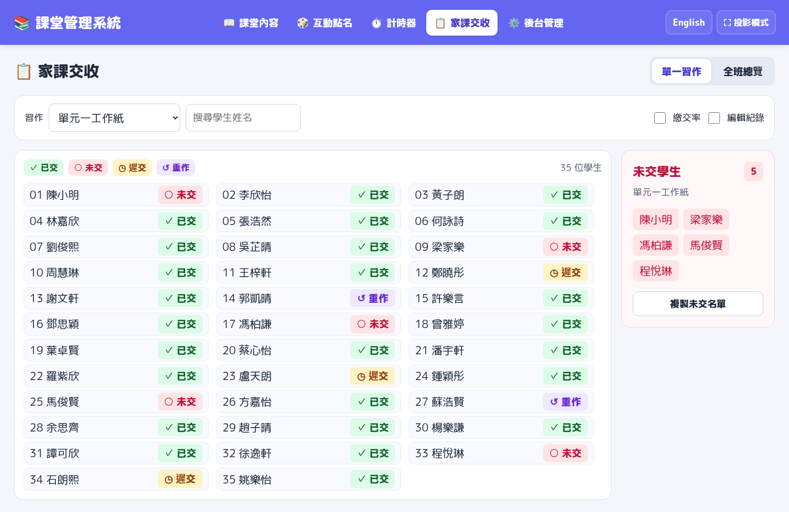

# v4.1 版面預覽

恢復原版 M PLUS Rounded 1c 圓體、22px 基本文字、藍紫色頂部導覽。字型已嵌入 HTML，離線使用也可載入。

以下截圖使用製作版面時建立的示例課堂與虛構學生名單，下載版不含這些資料。

## 課堂內容

主題置頂，學習目標、器材與公告在左，流程使用右側主要空間。時間與標題同行，減少無用留白。

## 家課交收

1440 × 900 的桌面示例：單份習作以三欄列出 35 人，右側顯示未交姓名。總繳交率預設隱藏；編輯模式下可撤銷上一次個別或全班修改。

後台分為課堂編輯、範本與歷史、名單與習作、儲存與備份。儲存、預覽和下載按鈕固定於底部；手機版會切換為單欄。
